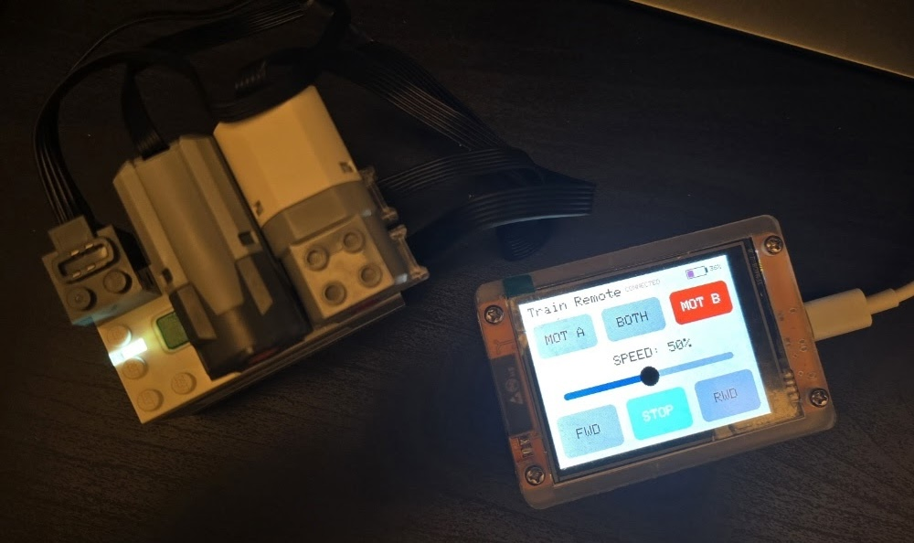
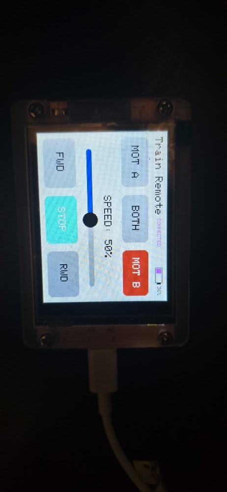

# Lego-PoweredUpHub-ESP32-BLE-CYD-Remote

A custom Bluetooth Low Energy (BLE) remote for Lego Powered Up (LPF2) trains using an ESP32 Cheap Yellow Display (CYD). Features a touchscreen interface for independent motor selection, speed sliders, and live battery telemetry—bypassing the need for official apps or third-party libraries.

## Features
* **Native ESP32 BLE:** Communicates directly with the official Lego Hub using the LPF2 protocol without relying on heavy third-party Lego libraries.
* **Independent Motor Selection:** Toggle control between Port A, Port B, or Both motors simultaneously.
* **Touch Slider Speed Control:** Drag the slider to set speeds from 0-100% in 5% increments. Tapping the middle of the slider snaps the speed to exactly 50%.
* **Drive States:** Instantly send Forward, Reverse, or Stop commands to the active motors.
* **Smart Battery Telemetry:** Fetches the Hub's battery level upon connection and filters out artificial voltage sag readings caused by heavy motor load.

## Hardware Requirements
* ESP32-2432S028R (CYD - Cheap Yellow Display)
* Lego Powered Up Hub (White Bluetooth Hub)
* Lego LPF2 Motors

## Software Setup
1. Install the **ESP32 Board Package** (Version 3.x.x supported).
2. Select **ESP32 Dev Module** in the Arduino IDE.
3. Install the following libraries:
   * `Adafruit_GFX`
   * `Adafruit_ST7789`
   * `XPT2046_Touchscreen`
4. Compile and upload. 

## Calibration Note
The touchscreen coordinates map `p.x` to the Y-axis and `p.y` to the X-axis to properly align the physical digitizer with the landscape TFT orientation. If your specific CYD screen registers mirrored touches, adjust the `map()` constraints inside the `loop()`.
